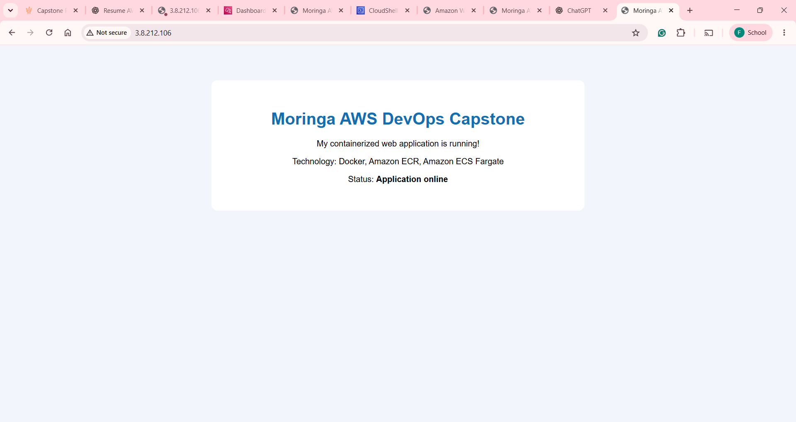
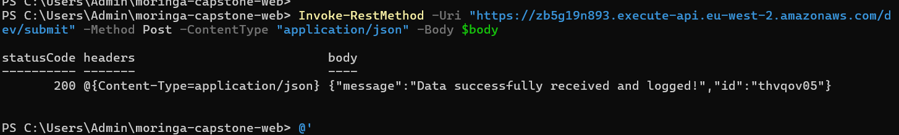
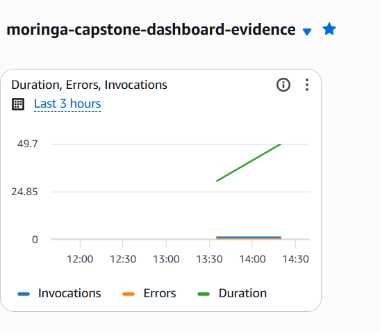

# Moringa AWS DevOps Capstone Project

## Project Overview

This project demonstrates a cloud-native application using Docker, Amazon ECR, Amazon ECS with AWS Fargate, AWS Lambda, API Gateway, CloudWatch, and AWS CloudFormation.

## Architecture

- **Docker:** Packages the web application into a container.
- **Amazon ECR:** Stores the container image.
- **Amazon ECS with AWS Fargate:** Runs the containerized website.
- **AWS CloudFormation:** Provisions the ECS cluster, task definition, service, and application log group.
- **Amazon API Gateway:** Exposes the backend through a POST endpoint.
- **AWS Lambda:** Validates JSON requests, logs submitted data, and returns a submission ID.
- **Amazon CloudWatch:** Stores Lambda logs and displays invocation, error, and duration metrics.

## Live Application

Website: http://3.8.212.106/

Region: `eu-west-2` (London)

## API Endpoint

POST https://zb5g19n893.execute-api.eu-west-2.amazonaws.com/dev/submit

Example request:

```json
{
  "name": "Moringa Student",
  "message": "Testing AWS DevOps Capstone API"
}
```

Example successful response:

```json
{
  "message": "Data successfully received and logged!",
  "id": "example123"
}
```

The returned ID is generated for each request and will vary.

## Project Structure

```text
moringa-capstone-web/
├── infrastructure.yml
├── lambda-api/
│   └── index.js
├── webapp/
│   ├── Dockerfile
│   └── index.html
├── screenshots/
│   ├── ecs-webapp.png
│   ├── api-test.png
│   └── cloudwatch-dashboard.png
└── README.md
```

## Deployment

### Prerequisites

- AWS CLI configured with appropriate permissions
- Docker
- An Amazon ECR repository containing the application image
- An ECS task execution role
- Existing public subnets and an HTTP-enabled security group

### Deploy the infrastructure

From the project root, run:

```powershell
aws cloudformation validate-template --template-body file://infrastructure.yml --region eu-west-2
```

To create the stack:

```powershell
aws cloudformation create-stack --stack-name MoringaCapstoneIaC --template-body file://infrastructure.yml --region eu-west-2
```

Check deployment status:

```powershell
aws cloudformation describe-stacks --stack-name MoringaCapstoneIaC --region eu-west-2 --query "Stacks[0].StackStatus" --output text
```

The existing deployed stack is named `MoringaCapstoneIaC`; do not rerun the create command against that same stack.

## Testing the API

Example PowerShell test:

```powershell
$body = @{
    name = "Moringa Student"
    message = "Testing AWS DevOps Capstone API"
} | ConvertTo-Json

Invoke-RestMethod -Uri "https://zb5g19n893.execute-api.eu-west-2.amazonaws.com/dev/submit" -Method Post -ContentType "application/json" -Body $body
```

A successful request returns a confirmation message and a submission ID. The Lambda function logs incoming events and submitted data to CloudWatch.

## Monitoring

CloudWatch dashboard: `moringa-capstone-dashboard-evidence`

The dashboard includes:
- Lambda Invocations
- Lambda Errors
- Lambda Duration

Lambda log group: `/aws/lambda/moringa-capstone-api`

## Evidence Screenshots

### 1. Live ECS Web Application



### 2. Successful API Gateway Test



Save the successful API test screenshot as `screenshots/api-test.png`.

### 3. CloudWatch Dashboard



Save a screenshot of the custom CloudWatch dashboard as `screenshots/cloudwatch-dashboard.png`.

## Repository Contents

This repository contains the CloudFormation infrastructure template, Lambda source code, Dockerized web application, deployment documentation, and evidence screenshots.

## Security Notes

- Never commit AWS credentials, temporary signed URLs, secret keys, or personal access tokens.
- Review AWS resource permissions before deployment.
- The sample website currently uses HTTP. HTTPS requires additional configuration.
